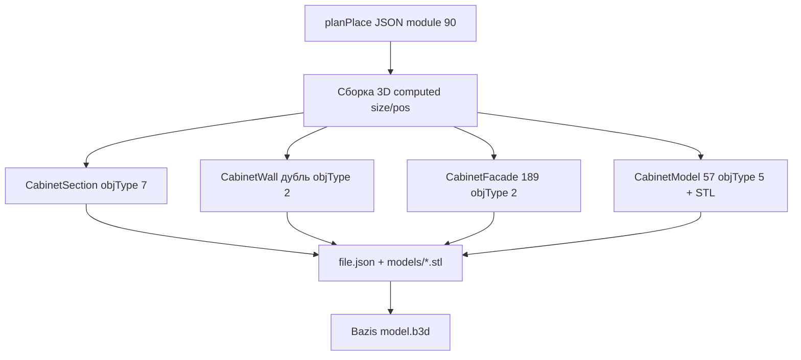

# Добор (id 90): как PlanPlace отдаёт сборку в Bazis (CFRN)

Источник: `constructor_code_reference/main_core_v2_part12_deobfuscated.js` → `exportToCFRN` (~4541).

Эталон JSON: `reference_b3d/planplace-shablony_korpusov-id90.json`.

## 1. Что в JSON и во что это превращается в сцене

| Узел JSON | Роль в 3D | `temp_type` в рефе |
|-----------|-----------|-------------------|
| Секция добор, `z: 32`, `pos.z: s:z-29` | Слот 32 мм у задней кромки шкафа | `CabinetSection` → **objType 7** (контейнер) |
| `wall` «дубль», `orientation: f` | ЛДСП-заглушка (тонко по Z) | `CabinetWall` → **objType 2** (панель) |
| `facade` id **189** | Декоративная пласть спереди | `CabinetFacade` → **objType 2** (панель) |
| `model` id **57** (саморезы) | Фурнитура из каталога 3D | `CabinetModel` → **objType 5** (меш + STL) |

В корневом шкафе добор — это `module` **90** (`shablony_korpusov`), размер `v:vysota_dobora` × глубина 32 мм.

## 2. Обход сцены при экспорте

Рекурсия `x(object, parentMatrix, depth)` по дереву `own_object`:

1. Берёт `userData.computed` (позиция, размер после формул `s:*`, `v:*`).
2. Собирает матрицу: pivot `(pivot+1)*size/2`, `c_rot`, для детей внутри стенки/фасада — матрица **родительской** панели.
3. По `temp_type` создаёт запись в `table.objects` и лист в `model.objs` с `{ tableIndex, matrix }`.

## 3. Панели (стенка «дубль» и фасад) — **objType: 2**

Общее для `CabinetWall` и `CabinetFacade`:

- `thickness` = толщина по оси материала:
  - `orientation: f` → `thickness = computed.size.z` (у нас в комнате это **16 мм** из `g0`, не 32 мм слота).
  - `h` → по `size.y`, поворот +90° вокруг X.
  - `v` → по `size.x`, поворот −90° вокруг Y.
- Для `f` после поворота: сдвиг якоря на **−thickness** вдоль локальной Z (строки 4897–4903 рефа) — то же заложено в `buildPanelWorldMatrix` в `bazis-cfrn-export.js`.
- **Контур** в плоскости панели: `computed.original_points` или прямоугольник `0,0` → `size.x`, `size.y` (`contour.elemType: 4`, рёбра `elemType: 1`).
- Материал: из `material` / декора (фасад **189** → `pp.libs.decors`).
- Дочерние `CabinetHole` на панели → массив `holes` с `infoIndex` в общую таблицу отверстий (глубина/диаметр).

У добора:

- **дубль**: `size` = `s:x` × `s:y-5` × `s:z` (в слоте 32 мм), `pos.z = s:z-32` — задняя ЛДСП.
- **Фасад**: `pos.z = 16` — вынесен вперёд на толщину фасада от задней плоскости слота.

## 4. Модели (саморез id 57) — **objType: 5**

Ветка `CabinetModel` (`al === true`):

1. Вызов `_get_model()` — геометрия из каталога `cabinet_model`.
2. Кэш STL: ключ `model + size.x + size.y + size.z` → файл в `table.triangles[]`, индекс в `triangleData`.
3. `materialArt` = код из `model_item` / каталога.
4. **Матрица** из `computed.pos` + pivot (формула pivot: `pivot * size/2`, не `(pivot+1)/2` как у панелей).
5. Размеры в JSON `"3,5"` — десятичная запятая PlanPlace → **3.5 мм** (важно для парсера выражений).

Саморезы **внутри** стенки «дубль» (крупные 16×16×35, `rot.x: 90`) и **на уровне секции** (мелкие 3.5×3.5×16) — оба идут как отдельные `objType: 5`, каждый со своей матрицей в дереве `model.objs` под секцией добора.

### Разбор вашего JSON (id 90)

| Узел | size / pos | В 3D после формул | В CFRN |
|------|------------|-------------------|--------|
| Секция добор | `z: 32`, `pos.z: s:z-29` | Слот 32 мм у задней кромки шкафа | **objType 7** — только дерево `model.objs` |
| `wall` «дубль» `orientation: f` | `s:x × (s:y-5) × s:z`, `pos.z: s:z-32` | Задняя ЛДСП 16 мм в слоте | **objType 2**, `thickness = size.z`, контур в плоскости XY |
| `facade` id **189** | `pos.z: 16` | Декор спереди от задней плоскости | **objType 2**, `thickness = size.z` (16 мм) |
| `model` **57** ×4 | 3,5×3,5×16 и 16×16×35 | GLB самореза, разный `rot` | **objType 5** + `models/model_N.stl`, **своя matrix** на каждый |

Саморезы на стенке «дубль» — дети `wall` в JSON, но в сцене рефа это всё равно отдельные `CabinetModel` с матрицей относительно секции добора (родительская матрица панели участвует при обходе).

## 5. Фурнитура с отверстиями — тоже objType: 5, но без STL

`CabinetFurniture` с детьми `CabinetHole`: **objType: 5** с полем `holes: [{ pos, dir, infoIndex }]`, без `triangleData`.  
Конфирматы/присадка на корпусе — эта ветка. Саморезы добора — именно **CabinetModel** (STL), не holes-only.

## 6. Секции — **objType: 7**

`CabinetSection`, корневой шкаф, модуль — только группировка в `model.objs`, без геометрии в `table`.

## 7. Что должно быть у нас в `bazis-cfrn-export.js`

| Элемент добора | Реф PlanPlace | Наш экспорт сейчас |
|----------------|---------------|-------------------|
| Стенка `f` | objType 2, matrix + contour | OK, если меш с `isDetail` / `__cldCfrnSizeMm`, `__cldPanelOrientation: 'f'` |
| Фасад | objType 2, thickness = z | Проверить: `isExportableMesh` не помечает `isFacade` — фасад может **не попасть** в CFRN |
| model 57 | objType 5, **world matrix** + STL | Исправлено: `matrixWorld16(isCabinetModel)` + `materialArt: MODEL_57` |
| Секция добор | objType 7 в иерархии | Есть `createContainerNode` по цепочке `getFurnitureSectionChain` |

## 8. Порядок внедрения (минимальный)

1. Сохранить id **90** в эталон (`reference_b3d`, `?refCatalog=1`).
2. В экспорте: включить меши с `userData.isFacade` в панели (`shouldTreatAsPanel` / `isExportableMesh`).
3. Для `userData.isCabinetModel`: писать `matrix = matrixWorld16(group)` (не identity), имя/артикул из `modelSpecId` **57**.
4. Сверить одну деталь: панель «дубль» в `model.b3d` vs наш CFRN → `tools/inspect-b3d.mjs`.

## 9. Схема потока

